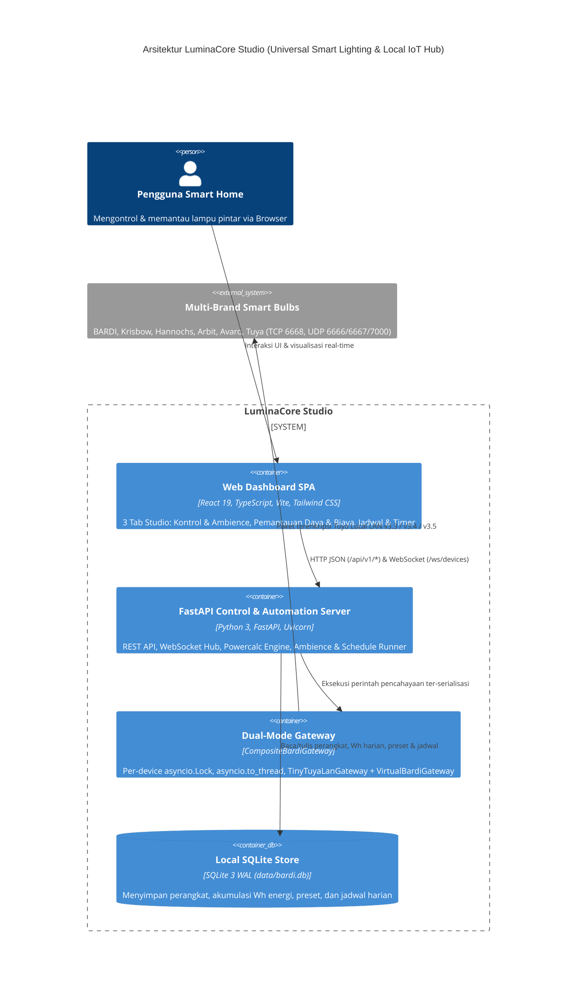

# LuminaCore Studio — Universal Smart Lighting & Local IoT Hub

**Aplikasi Web (`React 19` + `TypeScript` + `Tailwind CSS`) dan Backend Python (`FastAPI` + `TinyTuya` + `SQLite WAL`) untuk mengontrol, memantau daya, dan mengotomasi lampu pintar lintas merek berbasis protokol lokal Tuya/Smart Life.**

---

## 1. Gambaran Umum (`Overview`)

**LuminaCore Studio** adalah pusat kontrol pencahayaan pintar (*Smart Lighting & Local IoT Hub*) berbasis jaringan lokal (**Local LAN TCP Port `6668` & UDP Discovery `6666`/`6667`/`7000`**) tanpa ketergantungan pada server cloud saat runtime.

Aplikasi ini dirancang secara universal untuk mendukung berbagai merek lampu pintar di Indonesia yang menggunakan ekosistem protokol Tuya / Smart Life (`v3.3`, `v3.4`, `v3.5`), antara lain:
- **BARDI Smart Home** (RGBWW 9W/12W, LED Strip, Downlight)
- **Krisbow Sync**
- **Hannochs Smart LED**
- **Arbit Smart Lighting**
- **Avaro / Deon / Tuya Generic**

Selain mode perangkat keras fisik (**Physical LAN TinyTuya**), LuminaCore Studio dilengkapi dengan **Virtual Smart Bulb Simulator** bawaan sehingga seluruh fitur visualisasi cahaya, perubahan warna RGB, suhu warna `2700K–6500K`, pemantauan daya, dan otomasi dapat langsung dicoba di browser bahkan sebelum perangkat fisik terhubung.

---

## 2. Fitur Utama

### A. Kontrol Pencahayaan Real-Time & Dual-Mode (`LAN` + `Virtual Simulator`)
- **Kontrol Daya & Grup**: Nyalakan/matikan lampu secara individual atau seluruh lampu sekaligus (*Nyalakan Semua* / *Matikan Semua*), dilengkapi filter per ruangan.
- **Mode Kerja (`white`, `colour`, `scene`)**:
  - **Kecerahan (`Brightness 1%–100%`)** dengan *slider debounce* `150ms` untuk mencegah banjir paket TCP `6668` pada chip Wi-Fi lampu.
  - **Suhu Warna Putih (`CCT 0%–100%` / `2700K Warm White – 6500K Cool Daylight`)**.
  - **Warna RGB (`0–255`)** melalui *color picker* interaktif dan *quick color swatches*.
  - **Preset Cepat**: 5 preset bawaan (*Focus Daylight*, *Warm Relax*, *Sunset Lounge*, *Cinema Cyber*, *Night Light*) serta dukungan penyimpanan preset kustom melalui API.
- **Visualisasi Bohlam Interaktif ([BulbVisualizer.tsx](frontend/src/components/BulbVisualizer.tsx))**: Menampilkan pendaran warna RGB, suhu warna Kelvin, kecerahan, dan label merek perangkat secara langsung di kartu kontrol.

### B. Pemantauan Daya (`Smart Powercalc` + Sensor `DPS 19`) & Estimasi Biaya Listrik PLN
- **Deteksi Otomatis Sensor Fisik (`hardware_sensor`)**: Membaca telemetri daya langsung dari `DPS 19` apabila perangkat pintar memiliki chip sensor daya perangkat keras.
- **Estimasi Presisi `Smart Powercalc` (`powercalc_estimate`)**: Karena sebagian besar bohlam pintar standar tidak memiliki sensor arus fisik, LuminaCore menghitung beban Watt aktif secara matematis berdasarkan:
  - Daya maksimal lampu (`rated_wattage`, dapat diatur `1W–200W` per lampu, misal `9W` atau `12W`).
  - Konsumsi daya *standby* modul Wi-Fi saat lampu mati namun tetap terhubung (`0.4W` default).
  - Kurva intensitas kecerahan (`1%–100%`) serta beban kanal warna RGB atau putih CCT.
- **Akumulasi Energi Harian & Tagihan PLN**: Mengintegrasikan pemakaian energi terhadap waktu (`Wh` dan `kWh`) ke dalam SQLite, serta menghitung estimasi biaya listrik bulanan dalam **Rupiah (IDR)** menggunakan tarif PLN yang dapat dikonfigurasi (`BARDI_TARIFF_IDR_PER_KWH`, default `Rp 1.444,70/kWh`).

### C. Switch Warna Otomatis & Ambience Engine
Berjalan secara asinkron di sisi backend Python (tetap aktif meskipun tab browser ditutup) dengan batas aman interval `>= 3 detik`:
1. **Auto RGB Loop (`color_cycle`)**: Mengganti warna RGB lampu secara otomatis mengikuti palet tema pilihan (**Aurora**, **Cyberpunk**, **Sunset**, **Ocean**).
2. **Circadian Daylight Sync (`circadian`)**: Menyesuaikan suhu warna Kelvin (`2700K–6500K`) dan kecerahan lampu secara otomatis mengikuti siklus matahari sepanjang hari.
3. **Pomodoro Focus 25/5 (`pomodoro`)**: Siklus produktivitas 25 menit cahaya putih fokus (`6500K`, `100%`) yang otomatis berganti ke 5 menit cahaya hijau relaksasi saat waktu istirahat.
4. **Sleep Fade 15m (`sleep_fade`)**: Meredupkan kecerahan lampu secara bertahap dalam mode cahaya hangat (`2700K`) hingga lampu mati otomatis (`OFF`).

### D. Penjadwalan Harian (`Time-of-Day Scheduler`) & Countdown Timer
- **Jadwal Harian SQLite**: Buat jadwal eksekusi otomatis berdasarkan jam (`HH:MM`, format 24 jam) untuk 1 lampu spesifik atau seluruh lampu (`ALL`), lengkap dengan tombol *toggle* Aktif/Nonaktif.
- **Countdown Timer Cepat**: Tombol cepat `15m OFF`, `30m OFF`, `60m OFF`, dan pembatalan timer langsung pada setiap kartu lampu.

### E. LAN Auto-Discovery & 1-Click Import `devices.json` TinyTuya
- **UDP LAN Scanner**: Memindai jaringan Wi-Fi lokal untuk menemukan IP Address, Device ID, dan versi protokol (`3.3` / `3.4` / `3.5`) perangkat Tuya secara otomatis.
- **1-Click Import TinyTuya Wizard**: Tempelkan isi file `devices.json` hasil perintah `python -m tinytuya wizard` di modal **Import TinyTuya** untuk mendaftarkan banyak lampu lintas merek sekaligus.

---

## 3. Arsitektur Sistem



### Struktur Direktori Utama

| Direktori / File | Tanggung Jawab |
| :--- | :--- |
| [`backend/pyproject.toml`](backend/pyproject.toml) | Konfigurasi paket Python, dependensi (`fastapi`, `uvicorn`, `tinytuya`, `pydantic-settings`), `pytest`, dan `ruff`. |
| [`backend/bardi/config.py`](backend/bardi/config.py) | Konfigurasi environment (`BARDI_*`) yang divalidasi saat startup. |
| [`backend/bardi/logging.py`](backend/bardi/logging.py) | Structured JSON logger dengan filter redaksi otomatis `<REDACTED>` untuk `local_key` dan token akses. |
| [`backend/bardi/domain.py`](backend/bardi/domain.py) | Model domain Pydantic v2, algoritma `calculate_live_watts` (Powercalc), `calculate_circadian_state`, dan taksonomi error. |
| [`backend/bardi/repository.py`](backend/bardi/repository.py) | Persistensi SQLite (`WAL` mode) untuk tabel `devices`, `presets`, dan `schedules`. |
| [`backend/bardi/gateway.py`](backend/bardi/gateway.py) | `TinyTuyaLanGateway` (`asyncio.to_thread` + per-device `asyncio.Lock` + auto-populate `DEFAULT_BULB_DPSET`) dan `VirtualBardiGateway`. |
| [`backend/bardi/service.py`](backend/bardi/service.py) | Orkestrasi perangkat, agregasi energi & biaya PLN, *Ambience Automation Engine*, *Scheduler*, dan `WebSocketHub`. |
| [`backend/bardi/main.py`](backend/bardi/main.py) | Entrypoint FastAPI (`/api/v1/*`, `/ws/devices`), *constant-time token guard*, *background poller*, dan *static SPA hosting*. |
| [`backend/tests/test_bardi_api.py`](backend/tests/test_bardi_api.py) | Rangkaian unit & integration test backend (`pytest`). |
| [`frontend/src/App.tsx`](frontend/src/App.tsx) | Shell utama **LuminaCore Studio** dengan 3 tab navigasi, kartu ringkasan daya/biaya PLN, modal jadwal, dan modal import TinyTuya. |
| [`frontend/src/components/DeviceCard.tsx`](frontend/src/components/DeviceCard.tsx) | Kartu kontrol per lampu (Power, Mode, Slider `150ms` debounce, Ambience Engine, Countdown Timer, Preset). |
| [`frontend/src/components/BulbVisualizer.tsx`](frontend/src/components/BulbVisualizer.tsx) | Visualisasi bohlam SVG dengan efek pendaran warna RGB dan suhu warna Kelvin (`2700K–6500K`). |
| [`frontend/src/components/DeviceFormModal.tsx`](frontend/src/components/DeviceFormModal.tsx) | Form pendaftaran/pengaturan perangkat dengan pilihan mode `Virtual Simulator` vs `Physical LAN`, merek, dan Wattage. |
| [`frontend/src/__tests__/App.test.tsx`](frontend/src/__tests__/App.test.tsx) | Rangkaian komponen & UI test frontend (`vitest` + `@testing-library/react`). |
| [`docs/discovery/bardi-smart-lamp.md`](docs/discovery/bardi-smart-lamp.md) | Discovery Decision Record (`DEC-001`..`DEC-013`). |
| [`specs/bardi-smart-lamp.md`](specs/bardi-smart-lamp.md) | Spesifikasi teknis lengkap (`REQ-101`..`REQ-108`, `INV-101`..`INV-104`, `SEC-101`..`SEC-103`). |

---

## 4. Panduan Instalasi & Cara Menjalankan (`Quick Start`)

### Prasyarat
- **Python `>= 3.11`** (teruji pada Python `3.14`)
- **Node.js `>= 22.0.0`** & `npm`

### Langkah 1: Instal Dependensi & Build Frontend

```powershell
# 1. Instal dependensi backend Python (beserta pytest & ruff)
python -m pip install -e "backend[dev]"

# 2. Instal dependensi frontend & kompilasi bundle produksi ke frontend/dist
npm --prefix frontend install
npm --prefix frontend run build
```

### Langkah 2: Jalankan Server (1 Proses Terpadu: Backend + Web UI)

FastAPI secara otomatis menyajikan bundle web dari `frontend/dist`:

```powershell
cd backend
python -m uvicorn bardi.main:app --host 0.0.0.0 --port 8000
```

Buka browser ke **`http://localhost:8000`** (dokumentasi interaktif OpenAPI tersedia di **`http://localhost:8000/docs`**).

> **Pengembangan Frontend Terpisah (Hot-Reload Vite)**:
> Jika ingin mengedit UI secara live selama pengembangan, jalankan `npm --prefix frontend run dev` dan akses `http://localhost:5173` (Vite akan mem-proxy `/api` dan `/ws` ke port `8000`).

---

## 5. Cara Menghubungkan Lampu Pintar Fisik (`BARDI / Krisbow / Hannochs / Tuya`)

1. **Pasangkan Lampu ke Wi-Fi 2.4GHz**:
   Hubungkan lampu pintar Anda ke aplikasi **Smart Life** atau **Tuya Smart** di ponsel (pastikan berada di jaringan Wi-Fi lokal yang sama dengan komputer/server).
2. **Dapatkan `Device ID` & `Local Key`**:
   Buat akun developer gratis di [Tuya IoT Platform](https://iot.tuya.com/), tautkan akun aplikasi Smart Life Anda pada menu *Cloud -> Development -> Link Tuya App Account*, lalu jalankan wizard TinyTuya di terminal:
   ```powershell
   python -m tinytuya wizard
   ```
   Wizard ini akan menghasilkan file `devices.json` yang berisi `id` (`Device ID`), `key` (`Local Key` 16 karakter), `ip` (`IP Address`), dan `version` (`3.3`, `3.4`, atau `3.5`).
3. **Daftarkan ke LuminaCore Studio**:
   - **Cara Otomatis (Bulk Import)**: Klik tombol **Import TinyTuya** di bagian atas dashboard, tempelkan isi `devices.json`, lalu klik **Import Semua Perangkat**.
   - **Cara Scan / Manual**: Klik **Scan Wi-Fi Lokal** untuk memindai IP dan versi protokol lampu di jaringan lokal, klik **Gunakan**, pilih mode **Physical LAN (TinyTuya)**, pilih merek & daya Watt lampu, lalu masukkan `Local Key` Anda.

---

## 6. Konfigurasi Environment (`.env`)

Salin [`.env.example`](.env.example) menjadi `.env` jika ingin menyesuaikan konfigurasi:

| Variabel Environment | Default | Deskripsi |
| :--- | :--- | :--- |
| `BARDI_HOST` | `0.0.0.0` | Host bind untuk server FastAPI / Uvicorn. |
| `BARDI_PORT` | `8000` | Port HTTP & WebSocket server. |
| `BARDI_DB_PATH` | `data/bardi.db` | Lokasi file database SQLite (`WAL` mode). |
| `BARDI_ACCESS_TOKEN` | `""` *(kosong)* | Opsional. Jika diisi, seluruh mutasi API & WebSocket wajib menyertakan PIN/Token pada header `X-Bardi-Token`. |
| `BARDI_SOCKET_TIMEOUT_SEC` | `3.0` | Batas waktu koneksi TCP port `6668` ke lampu fisik (`0.5..15.0` detik). |
| `BARDI_SOCKET_RETRIES` | `1` | Jumlah percobaan rekoneksi otomatis saat socket lampu terputus (`0..3`). |
| `BARDI_POLL_INTERVAL_SEC` | `10.0` | Interval sinkronisasi status lampu di latar belakang (`2.0..300.0` detik). |
| `BARDI_SCAN_TIMEOUT_SEC` | `5.0` | Durasi pemindaian broadcast UDP LAN (`1.0..30.0` detik). |
| `BARDI_SEED_VIRTUAL_DEVICES` | `true` | Menyediakan 2 lampu virtual simulator otomatis saat database masih kosong. |
| `BARDI_TARIFF_IDR_PER_KWH` | `1444.70` | Tarif listrik PLN per kWh (Rupiah) untuk kalkulasi estimasi biaya bulanan. |
| `BARDI_STANDBY_WATTAGE` | `0.4` | Konsumsi daya *standby* modul Wi-Fi lampu saat berstatus OFF namun online (`Watt`). |
| `BARDI_AUTOMATION_TICK_SEC` | `2.0` | Interval evaluasi background runner untuk Ambience Engine, Timer, dan Jadwal. |
| `VITE_API_BASE_URL` | `""` *(relatif)* | Opsional. Base URL API kustom jika frontend di-host terpisah dari backend. |

---

## 7. Ringkasan Endpoint REST & WebSocket API

| Metode & Path | Deskripsi |
| :--- | :--- |
| `GET /api/v1/health` | Status kesehatan server, jumlah perangkat (`virtual_count`, `lan_count`), dan status proteksi auth. |
| `GET /api/v1/auth/status` | Memeriksa apakah `BARDI_ACCESS_TOKEN` diaktifkan dan apakah header `X-Bardi-Token` valid. |
| `GET /api/v1/devices` | Mengambil daftar seluruh perangkat (dengan `local_key` ter-masking `****xxxx` dan telemetri `live_watts`). |
| `POST /api/v1/devices` | Mendaftarkan lampu pintar baru (`lan` atau `virtual`). |
| `POST /api/v1/devices/import-tinytuya` | Bulk import array perangkat dari format `devices.json` TinyTuya Wizard. |
| `PUT /api/v1/devices/{device_id}` | Memperbarui konfigurasi lampu (nama, merek, Wattage, IP, versi protokol, mode koneksi, atau `local_key`). |
| `DELETE /api/v1/devices/{device_id}` | Menghapus lampu dari SQLite dan menutup koneksi socket. |
| `POST /api/v1/devices/scan` | Memindai perangkat di Wi-Fi lokal melalui broadcast UDP TinyTuya & katalog simulator. |
| `POST /api/v1/devices/{device_id}/command` | Mengirim perintah pencahayaan (`power`, `mode`, `brightness_pct`, `cct_pct`, `rgb`, `preset_id`). |
| `POST /api/v1/devices/{device_id}/automation` | Mengaktifkan/mematikan Ambience Engine (`none`, `color_cycle`, `circadian`, `pomodoro`, `sleep_fade`). |
| `POST /api/v1/devices/{device_id}/timer` | Mengatur atau membatalkan Countdown Timer per perangkat (`minutes: 0..720`). |
| `POST /api/v1/devices/{device_id}/refresh` | Meminta pembacaan ulang status DPS langsung dari perangkat. |
| `GET /api/v1/energy/summary` | Ringkasan daya aktif total (`W`), akumulasi energi (`Wh`/`kWh`), estimasi biaya PLN (`IDR`), dan rincian per lampu. |
| `GET / POST / DELETE /api/v1/presets` | Mengelola daftar preset pencahayaan bawaan maupun kustom. |
| `GET / POST / PATCH / DELETE /api/v1/schedules` | Mengelola jadwal waktu harian (`HH:MM`, target perangkat/`ALL`, toggle `enabled`). |
| `WS /ws/devices` | Kanal WebSocket real-time untuk menerima event `snapshot`, `device_updated`, `device_removed`, dan `scan_completed`. |

---

## 8. Pengujian & Verifikasi Kualitas

Jalankan perintah berikut untuk memverifikasi seluruh komponen backend, frontend, dan spesifikasi:

```powershell
# 1. Linter & Test Suite Backend Python (11 tests)
python -m ruff check --no-cache backend
python -m pytest backend -v

# 2. Typecheck, Unit/Component Test (6 tests) & Production Build Frontend
npm --prefix frontend run typecheck
npm --prefix frontend test
npm --prefix frontend run build

# 3. Validasi Spesifikasi, Sprint DAG & Tata Kelola Workspace
node .agents/skills/to-spec/scripts/validate-spec.mjs specs/bardi-smart-lamp.md
node .agents/skills/to-tickets/scripts/validate-board.mjs docs/sprint/SPRINT.md
npm test
```

---

## Lisensi

Dirilis di bawah lisensi MIT — lihat [LICENSE](LICENSE) dan kebijakan keamanan pada [SECURITY.md](SECURITY.md).
