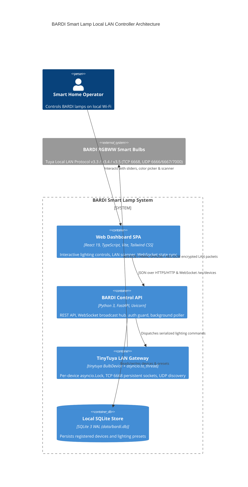
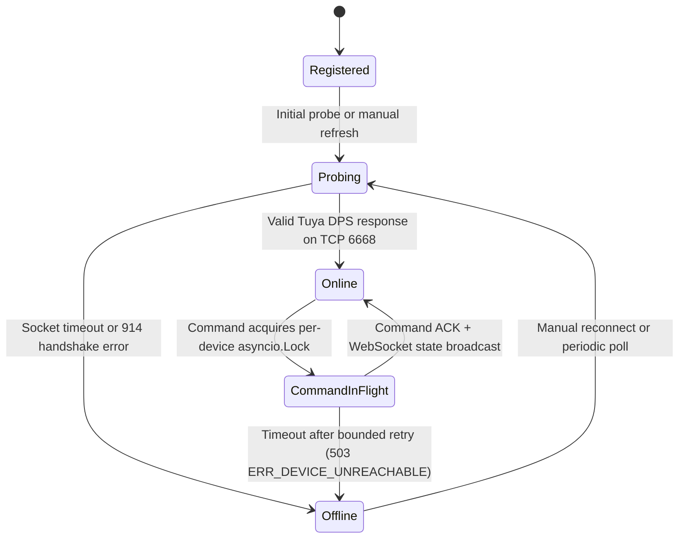
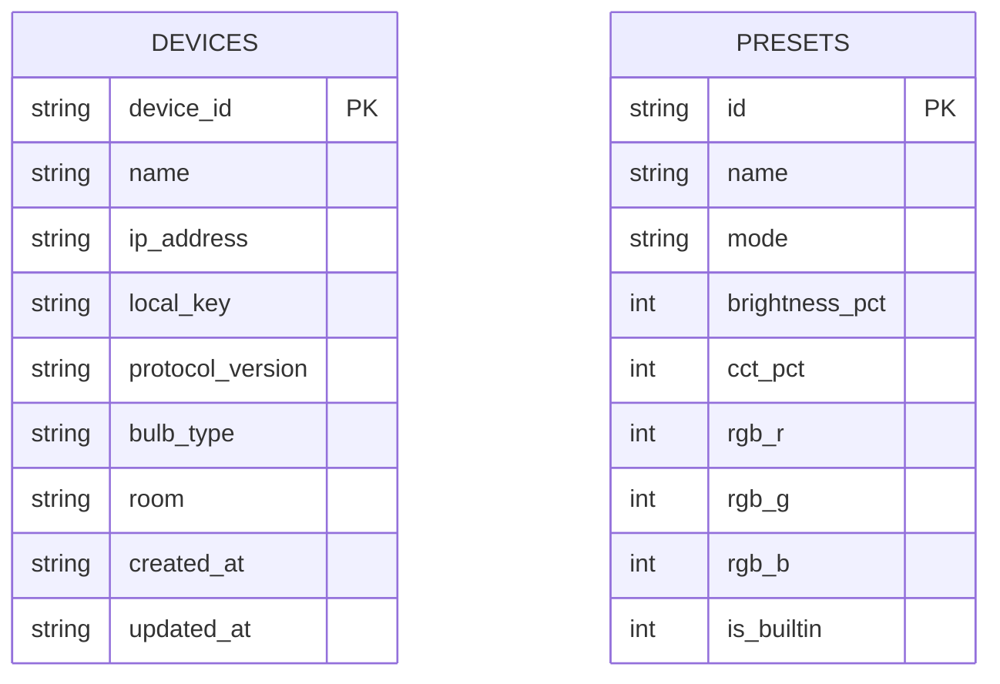
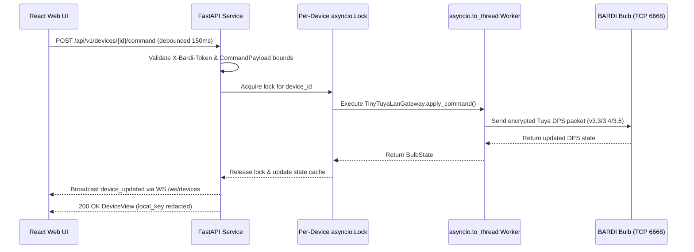

# Spec: BARDI Smart Lamp Local LAN Web & Python Controller

- **Status**: `ready-for-tickets`
- **Feature Slug**: `bardi-smart-lamp`
- **DDR / PRD Source**: `docs/discovery/bardi-smart-lamp.md`
- **Quality Bar**: `production` (industrial standard; MVP/stub/hardcoded shortcuts forbidden; inapplicable gates marked `N/A — <reason>`)
- **Verification Command**: `npm test`
- **Readiness Verdict**: `READY FOR TICKETS`

---

## 1. Problem, Scope & Non-Goals

- **Problem & Goal**: Build a local-LAN-first Python backend (`backend/` with `FastAPI`, `tinytuya`, `sqlite3`, and `pydantic-settings`) and modern Web dashboard (`frontend/` with `React`, `TypeScript`, `Vite`, and `Tailwind CSS`) to discover, register, and control one or more BARDI RGB+CCT (`RGBWW`) smart lamps directly over local Wi-Fi (TCP `6668` and UDP `6666`/`6667`/`7000`) with real-time WebSocket state synchronization (`Source: DEC-001`..`DEC-007`).
- **In Scope**:
  - `REQ-101`: Startup-validated configuration (`BardiSettings`), structured JSON logger with `<REDACTED>` credential masking, SQLite persistence (`devices` & `presets` tables with optional seeded virtual BARDI bulbs), and optional constant-time `X-Bardi-Token` authentication (`DEC-005`, `DEC-006`, `DEC-008`).
  - `REQ-102`: Deep-module `BardiGatewayPort` with `CompositeBardiGateway` routing `"lan"` devices to `TinyTuyaLanGateway` (`tinytuya.BulbDevice` and `tinytuya.deviceScan` inside `asyncio.to_thread` with per-device `asyncio.Lock`) and `"virtual"` devices to `VirtualBardiGateway` for hardware-free interactive simulation (`DEC-001`, `DEC-002`, `DEC-007`, `DEC-008`).
  - `REQ-103`: FastAPI REST endpoints (`/api/v1/health`, `/api/v1/auth/status`, `/api/v1/devices`, `/api/v1/devices/scan`, `/api/v1/devices/{device_id}/command`, `/api/v1/devices/{device_id}/refresh`, `/api/v1/presets`) and real-time WebSocket hub (`/ws/devices`) with background polling and static SPA hosting (`DEC-003`, `DEC-004`, `DEC-007`).
  - `REQ-104`: React + TypeScript + Tailwind CSS Web UI featuring live glowing visual bulb simulator preview, multi-device grid (`Virtual Simulator` vs `Physical LAN` mode selector), LAN auto-discovery scanner modal, device registration/edit modal, power toggle, work mode switcher (`white`, `colour`, `scene`), `150ms`-debounced Brightness (`1..100%`), CCT (`2700K..6500K`), and RGB (`0..255`) controls, quick presets bar, and optional access token lock screen (`DEC-003`, `DEC-004`, `DEC-006`, `DEC-007`, `DEC-008`).
  - `REQ-105`: Multi-brand identity (**LuminaCore Studio**), per-device `brand` & `rated_wattage` (`1..200W`), Smart Powercalc & hardware `DPS 19` live wattage calculation, SQLite daily `Wh`/`kWh` accumulation, and PLN Rupiah cost estimation (`GET /api/v1/energy/summary`) (`DEC-009`, `DEC-010`, `DEC-013`).
  - `REQ-106`: Automatic Color & Ambience Engine (`POST /api/v1/devices/{device_id}/automation`) supporting `color_cycle` (`aurora`, `cyberpunk`, `sunset`, `ocean` palettes), `circadian` daylight sync, `pomodoro` focus/break cycle, and `sleep_fade` gradual dim-to-off (`DEC-011`).
  - `REQ-107`: SQLite Time-of-Day Scheduler (`GET/POST/PATCH/DELETE /api/v1/schedules`) and per-device Countdown Timer (`POST /api/v1/devices/{device_id}/timer`) (`DEC-012`).
  - `REQ-108`: 1-Click TinyTuya `devices.json` Bulk Import (`POST /api/v1/devices/import-tinytuya`) and multi-brand UI studio tabs (`Kontrol & Ambience`, `Pemantauan Daya & Biaya`, `Jadwal & Timer`) (`DEC-009`, `DEC-013`).
  - `REQ-109`: Live ticking digital countdown timer (`HH:MM:SS` / `MM:SS`), visual progress bar (`timer_total_seconds`), custom minute input (`1..720`), ON/OFF action selector, and live countdown display for `sleep_fade` & `pomodoro` automations (`DEC-014`).
  - `REQ-110`: Dynamic collapsible top navbar (collapsing into a compact floating glass pill), collapsible telemetry/info summary panels, `localStorage` state persistence, and `Alt+N` keyboard shortcut (`DEC-015`).
- **Out of Scope**:
  - Runtime Tuya Cloud REST API calls or OAuth cloud login flows (`DEC-001`).
  - Cron/calendar automation daemon or voice-assistant cloud skills (`DEC-004`).
  - External database daemons such as PostgreSQL or MySQL (`DEC-005`).

## 2. Reusable Codebase Assets & Touchpoints (`CONTEXT.md`)

- **Shared UI / Widgets & Tokens to Reuse/Extend**: `N/A — repository root houses @rafaelghif/aac-core CLI and governance layer without an existing frontend UI (CONTEXT.md:56-64); frontend/ will establish shared UI primitives in frontend/src/components/ui/`.
- **Shared Utils / Hooks / State Holders / Schemas / API Clients**:
  - `.agents/skills/index-project/scripts/scan-repo.mjs` (monorepo sub-workspace discovery for `backend/` and `frontend/`)
  - `.agents/hooks.json` (`quality-gate-stop-sensor`, `production-no-mock-guard`, `post-edit-backpressure`)
  - `.agents/skills/implement/scripts/audit-diff.mjs` (non-echoing secret & production fake auditor)
- **Target Modules & Sibling Callers**:
  - `backend/pyproject.toml`, `backend/bardi/__init__.py`, `backend/bardi/config.py`, `backend/bardi/logging.py`, `backend/bardi/domain.py`, `backend/bardi/repository.py`, `backend/bardi/gateway.py`, `backend/bardi/service.py`, `backend/bardi/main.py`, `backend/tests/test_bardi_api.py`
  - `frontend/package.json`, `frontend/tsconfig.json`, `frontend/vite.config.ts`, `frontend/index.html`, `frontend/src/types/bardi.ts`, `frontend/src/lib/api.ts`, `frontend/src/hooks/useDebouncedCallback.ts`, `frontend/src/hooks/useBardiSocket.ts`, `frontend/src/components/*`, `frontend/src/App.tsx`, `frontend/src/__tests__/App.test.tsx`

## 3. Domain Model, Invariants, State Machine & Design Diagrams

| ID | Invariant | Forbidden State / Transition | Enforced By | Source |
| :--- | :--- | :--- | :--- | :--- |
| `INV-101` | Device `local_key` and `BARDI_ACCESS_TOKEN` must never be emitted in plaintext in HTTP GET responses, WebSocket frames, error messages, or log output. | Raw `local_key` present in `DeviceView` or log records. | `DeviceView` schema (`masked_key` only) & `RedactingJsonFormatter` | `DEC-005`, `DEC-006` |
| `INV-102` | All synchronous `tinytuya` socket operations must execute inside `asyncio.to_thread` under a per-`device_id` `asyncio.Lock`. | Direct synchronous `tinytuya` call on the main event loop or concurrent socket writes to one bulb. | `TinyTuyaLanGateway` & `BardiControlService` | `DEC-007` |
| `INV-103` | Production gateway code must never fabricate online status or fake DPS data when a physical lamp is unreachable. | Returning synthetic `online: true` when TCP `6668` connection fails. | `TinyTuyaLanGateway` & `audit-diff.mjs` | `DEC-007` |
| `INV-104` | Lighting parameters must obey strict domain bounds: `brightness_pct` in `1..100`, `cct_pct` in `0..100` (`2700K..6500K`), `rgb` channels in `0..255`, `protocol_version` in `{"3.3", "3.4", "3.5"}`, `bulb_type` in `{"A", "B"}`, `mode` in `{"white", "colour", "scene"}`. | Out-of-range DPS payloads dispatched to `tinytuya.BulbDevice`. | Pydantic v2 domain models & TypeScript validators | `DEC-002`, `DEC-004` |

| State | Allowed Transitions | Forbidden Transitions | Trigger / Guard |
| :--- | :--- | :--- | :--- |
| `Registered` | `Probing` | `CommandInFlight` | Device loaded from SQLite (`Source: ST-101`) |
| `Probing` | `Online`, `Offline` | `Registered` | TCP `6668` status probe completes or times out (`Source: ST-101`) |
| `Online` | `CommandInFlight`, `Probing`, `Offline` | `Registered` | Per-device `asyncio.Lock` acquired (`Source: ST-101`) |
| `CommandInFlight` | `Online`, `Offline` | `Registered` | Command ACK or socket error after bounded retry (`Source: ST-101`) |
| `Offline` | `Probing` | `CommandInFlight` | User clicks Reconnect or background poll triggers (`Source: ST-101`) |

- **UI States (if UI)**:
  - **Loading**: Skeleton cards during initial fetch and active progress banner during LAN UDP scan.
  - **Empty**: Zero-device onboarding screen with buttons to launch LAN UDP Auto-Discovery or register a BARDI lamp manually.
  - **Validation Error**: Immediate inline validation on Device ID (`8..64` chars), IPv4 address format, Local Key (`16..32` chars), protocol version (`3.3`/`3.4`/`3.5`), and lighting bounds.
  - **Server / Offline Error**: Amber/Red `Offline` badge displaying exact last error message and 1-click Reconnect action; toast alert on `503 ERR_DEVICE_UNREACHABLE`.
  - **Disabled / In-Flight**: Controls disabled while device is `Offline` or command is in flight; continuous sliders debounced at `150ms`.
  - **Responsive & Disposal**: Responsive 1/2/3-column CSS Grid layout; WebSocket connection and debounce timers cleaned up on unmount.

## 4. Functional Requirements & Acceptance Criteria

| ID | Requirement | Given / When / Then | Priority | Source |
| :--- | :--- | :--- | :---: | :--- |
| `REQ-101` | Startup-validated configuration, redacted logging & SQLite persistence | **Given** environment variables (`BARDI_DB_PATH`, `BARDI_ACCESS_TOKEN`, `BARDI_SOCKET_TIMEOUT_SEC`, etc.), **when** the backend starts, **then** it validates all settings, initializes SQLite tables (`devices`, `presets`) in WAL mode with default lighting presets, and redacts any `local_key` or token as `<REDACTED>` in structured JSON logs. | `must` | `DEC-005`, `DEC-006` |
| `REQ-102` | Non-blocking TinyTuya LAN gateway & UDP auto-discovery | **Given** registered BARDI RGBWW bulb credentials (`device_id`, `ip_address`, `local_key`, `protocol_version` `3.3`/`3.4`/`3.5`, `bulb_type` `B`/`A`), **when** status probe, lighting mutation, or LAN UDP scan is invoked, **then** `TinyTuyaLanGateway` runs `tinytuya` inside `asyncio.to_thread` serialized by a per-device `asyncio.Lock`, reuses persistent sockets with bounded retry on socket reset, and maps unreachable bulbs to `DeviceUnreachableError`. | `must` | `DEC-001`, `DEC-002`, `DEC-007` |
| `REQ-103` | REST API, constant-time auth guard & WebSocket real-time hub | **Given** the FastAPI server, **when** clients call `/api/v1/devices`, `/api/v1/devices/scan`, `/api/v1/devices/{id}/command`, `/api/v1/presets`, or connect to `/ws/devices`, **then** the server enforces `X-Bardi-Token` via `hmac.compare_digest` when `BARDI_ACCESS_TOKEN` is set, returns `DeviceView` with `local_key` masked (`****`), broadcasts state updates over WebSocket, and returns `503 ERR_DEVICE_UNREACHABLE` on offline hardware. | `must` | `DEC-003`, `DEC-004`, `DEC-006`, `DEC-007` |
| `REQ-104` | Interactive React + TypeScript Web Dashboard | **Given** the web application, **when** an operator views or controls smart lamps, **then** the UI renders real-time online/offline status via WebSocket, supports LAN scan auto-fill & manual device CRUD, toggles Power & Work Mode (`white`, `colour`, `scene`), debounces Brightness (`1..100%`), CCT (`2700K..6500K`), and RGB (`0..255`) slider adjustments at `150ms`, applies 1-click presets, and cleans up WebSocket/timers on unmount. | `must` | `DEC-003`, `DEC-004`, `DEC-007` |
| `REQ-105` | Multi-brand Smart Powercalc & PLN energy cost telemetry | **Given** registered smart lamps with `brand` and `rated_wattage` (`1..200W`), **when** lamps operate or `GET /api/v1/energy/summary` is queried, **then** the backend computes real-time wattage from brightness/mode/RGB (or hardware `DPS 19` when present) plus `0.4W` standby draw, integrates `energy_wh_today` in SQLite, and returns aggregate Watts, kWh, and estimated monthly IDR electricity cost (`BARDI_TARIFF_IDR_PER_KWH`). | `must` | `DEC-009`, `DEC-010`, `DEC-013` |
| `REQ-106` | Automatic Color & Ambience Engine | **Given** a registered smart lamp, **when** `POST /api/v1/devices/{id}/automation` activates `color_cycle`, `circadian`, `pomodoro`, or `sleep_fade`, **then** the backend automation worker steps colors/Kelvin/brightness at bounded intervals (`>= 3s`) and broadcasts live state updates via WebSocket. | `must` | `DEC-011` |
| `REQ-107` | Persistent daily schedules & per-device countdown timer | **Given** daily schedules (`HH:MM`, target device or `ALL`, power/preset action) and per-device countdown timers (`minutes: 1..720`), **when** the scheduled minute or countdown expiration is reached, **then** the backend executes the target lighting mutation and updates WebSocket clients. | `must` | `DEC-012` |
| `REQ-108` | TinyTuya bulk JSON import & LuminaCore Studio multi-tab UI | **Given** a `devices.json` array from TinyTuya Wizard, **when** submitted to `POST /api/v1/devices/import-tinytuya` or via the LuminaCore Studio Import Modal, **then** valid devices are upserted with redacted `local_key` and exposed across the Control, Energy, and Schedule UI tabs. | `must` | `DEC-009`, `DEC-013` |
| `REQ-109` | Live digital countdown timer, progress bar, custom input & timed ambience countdown | **Given** an active device countdown timer (`timer_expires_at`, `timer_total_seconds`) or timed automation (`sleep_fade`, `pomodoro`), **when** rendered in `DeviceCard`, **then** the UI updates remaining time (`MM:SS` / `HH:MM:SS`) and progress bar every second, supports custom minute input (`1..720`) with ON/OFF target power, and cleans up intervals on unmount. | `must` | `DEC-014` |
| `REQ-110` | Dynamic collapsible navbar & telemetry panels with `localStorage` persistence | **Given** the LuminaCore Studio header and telemetry panels, **when** the operator clicks the collapse/expand toggle or presses `Alt+N`, **then** the navbar collapses into a floating mini pill (or expands back) and persists the preference in `localStorage`. | `must` | `DEC-015` |

## 5. Non-Functional & Performance Optimization Budgets

| ID | Attribute | Budget / Target | Optimization Strategy | Measurement Method | Behavior When Exceeded | Source |
| :--- | :--- | :--- | :--- | :--- | :--- | :--- |
| `NFR-101` | Local LAN command dispatch overhead | `< 25 ms` API layer overhead; `< 3,000 ms` bounded socket timeout (`BARDI_SOCKET_TIMEOUT_SEC`) | Persistent TCP sockets (`set_socketPersistent(True)`) and in-memory device state cache | Automated API latency assertion in `backend/tests/test_bardi_api.py` | Abort socket operation at `BARDI_SOCKET_TIMEOUT_SEC` and return `503 ERR_DEVICE_UNREACHABLE` | `DEC-001`, `DEC-007` |
| `NFR-102` | Asyncio event-loop non-blocking concurrency | `0` blocking socket calls on main event loop; `1` active lock per `device_id` | Wrap all `tinytuya` calls in `asyncio.to_thread` with per-device `asyncio.Lock` dictionary | Concurrent command serialization test in `backend/tests/test_bardi_api.py` | Queued per-device requests wait on lock without blocking other devices or health checks | `DEC-007` |
| `NFR-103` | UI slider command rate limiting | `150 ms` debounce interval (`<= 7` requests/sec per continuous slider drag) | `useDebouncedCallback` hook with timer cancellation on unmount | Frontend unit test with fake timers in `frontend/src/__tests__/App.test.tsx` | Intermediate drag events coalesced into latest value before HTTP POST | `DEC-007` |

## 6. Security, Credential Hygiene & Abuse Cases

| ID | Threat / Control Area | Rule | Verification | Source |
| :--- | :--- | :--- | :--- | :--- |
| `SEC-101` | Local LAN Access Control | When `BARDI_ACCESS_TOKEN` is non-empty, validate `X-Bardi-Token` header (or `?token=` on WebSocket) using `hmac.compare_digest`; reject missing/mismatched tokens with `401 ERR_UNAUTHORIZED`. | Automated auth tests (`401` vs `200`) in `backend/tests/test_bardi_api.py` | `DEC-006` |
| `SEC-102` | Strict Boundary Parsing & Concurrency | Validate IPv4 addresses, `device_id` pattern, `local_key` length (`16..32`), and lighting numeric bounds via Pydantic v2; guard `/api/v1/devices/scan` with a scan mutex (`429 ERR_SCAN_IN_PROGRESS` if already running). | Boundary matrix (`N-1`/`N`/`N+1`) & concurrent scan lock test | `DEC-002`, `DEC-004` |
| `SEC-103` | Credential & `local_key` Redaction | Never return raw `local_key` in `DeviceView` (`GET /api/v1/devices` outputs `has_local_key: true` and `masked_key: "****" + last 4 chars`), and mask `local_key` / `BARDI_ACCESS_TOKEN` as `<REDACTED>` in logs. | Redaction unit test + `audit-diff.mjs` scan | `DEC-005`, `INV-101` |

## 7. Configurability, Logging, API Contract & Persistence

- **Config Contract (Zero Hardcoded Values)**: `backend/bardi/config.py` loads `BARDI_HOST`, `BARDI_PORT`, `BARDI_DB_PATH`, `BARDI_ACCESS_TOKEN`, `BARDI_SOCKET_TIMEOUT_SEC`, `BARDI_SOCKET_RETRIES`, `BARDI_POLL_INTERVAL_SEC`, `BARDI_SCAN_TIMEOUT_SEC`, `BARDI_CORS_ORIGINS`, and `BARDI_STATIC_DIR` with strict numeric range validation (`Source: DEC-005`, `DEC-006`, `DEC-007`).
- **Logging & Audit Contract**: `backend/bardi/logging.py` outputs single-line JSON records (`timestamp`, `level`, `logger`, `event`, `trace_id`, `device_id`, `latency_ms`, `error_code`) and scrubs any secret key matching `local_key`, `token`, `secret`, or `password` into `<REDACTED>` (`Source: DEC-005`).
- **API Contract & Schema Compatibility**: FastAPI auto-generates OpenAPI 3.1 schema at `/openapi.json` and `/docs`; all endpoints are versioned under `/api/v1/*` with additive-only field evolution (`Source: DEC-003`).
- **Entry Signatures / Schemas**:
  - `GET /api/v1/health` → `{ status: "ok", version: "1.0.0", auth_required: bool, device_count: int }`
  - `GET /api/v1/auth/status` → `{ auth_required: bool, authenticated: bool }`
  - `GET /api/v1/devices` → `{ devices: DeviceView[] }`
  - `POST /api/v1/devices` → `DeviceCreateRequest` → `201 DeviceView`
  - `PUT /api/v1/devices/{device_id}` → `DeviceUpdateRequest` → `200 DeviceView`
  - `DELETE /api/v1/devices/{device_id}` → `204 No Content`
  - `POST /api/v1/devices/scan` → `{ discovered: DiscoveredDevice[] }`
  - `POST /api/v1/devices/{device_id}/command` → `LightingCommandRequest` → `200 DeviceView`
  - `POST /api/v1/devices/{device_id}/refresh` → `200 DeviceView`
  - `GET /api/v1/presets`, `POST /api/v1/presets`, `DELETE /api/v1/presets/{preset_id}`
  - `WS /ws/devices` → JSON event frames `{ event, payload, timestamp }`
- **Persistence & Migrations**: Local SQLite database (`BARDI_DB_PATH`, default `data/bardi.db`) initialized idempotently with `PRAGMA journal_mode=WAL` and seeded with 5 default lighting presets (`Focus Daylight`, `Warm Relax`, `Sunset Lounge`, `Cinema Cyber`, `Night Light`) (`Source: DEC-005`).

| ID | Condition | Status / Code | Recovery Behavior | Source |
| :--- | :--- | :--- | :--- | :--- |
| `ERR-101` | Invalid or missing `X-Bardi-Token` when `BARDI_ACCESS_TOKEN` is configured | `401 ERR_UNAUTHORIZED` | Prompt operator for access token in Web UI lock modal | `DEC-006` |
| `ERR-102` | Payload fails Pydantic boundary validation (e.g., `brightness_pct > 100`, invalid IPv4) | `422 ERR_VALIDATION` | Return structured field violation details; keep current bulb state unchanged | `DEC-004` |
| `ERR-103` | Target `device_id` or `preset_id` does not exist in SQLite | `404 ERR_NOT_FOUND` | Refresh device/preset list in UI | `DEC-005` |
| `ERR-104` | Duplicate `device_id` on `POST /api/v1/devices` | `409 ERR_DUPLICATE_DEVICE` | Suggest editing existing device via `PUT /api/v1/devices/{device_id}` | `DEC-005` |
| `ERR-105` | Concurrent LAN UDP scan already in progress | `429 ERR_SCAN_IN_PROGRESS` | Wait for active scan completion event | `DEC-004` |
| `ERR-106` | Physical BARDI lamp unreachable on TCP `6668` or fails Tuya key/version handshake | `503 ERR_DEVICE_UNREACHABLE` | Close stale socket, retry up to `BARDI_SOCKET_RETRIES`, mark device `offline`, broadcast via WebSocket | `DEC-007` |

## 8. Resilience, Rollout, Observability & Test Strategy

- **Failure Modes**: Socket timeouts (`BARDI_SOCKET_TIMEOUT_SEC=3.0`) and broken persistent TCP pipes trigger automatic socket close + bounded retry (`BARDI_SOCKET_RETRIES=1`). Unreachable bulbs degrade gracefully to `online: false` with `last_error` diagnostic text without crashing other devices or the background poller.
- **Rollout, Feature-Flag, Canary & Rollback SOP**: Local single-process deployment (`uvicorn bardi.main:app`) serving the compiled `frontend/dist` bundle when present. Rollback is achieved by restoring the previous git revision and SQLite `data/bardi.db` backup file.
- **Observability (SLI/SLO & Runbook)**: `/api/v1/health` exposes liveness, auth configuration state, and registered device count; structured JSON logs track every LAN command latency (`latency_ms`) and socket error (`error_code`) with `trace_id`.
- **Public Seams & Test Matrix**:
  - Backend public seams: FastAPI ASGI app (`bardi.main:create_app`) tested via `fastapi.testclient.TestClient` with injected test `BardiGatewayPort` double in `backend/tests/test_bardi_api.py`, plus direct unit tests for `TinyTuyaLanGateway`, `SQLiteRepository`, and `RedactingJsonFormatter`.
  - Frontend public seams: `<App />` and API/hook utilities tested via `vitest` and `@testing-library/react` in `frontend/src/__tests__/App.test.tsx`.

## 9. Traceability Matrix

| Requirement | Invariants / Security | Ticket(s) | Public Seam | Test(s) |
| :--- | :--- | :--- | :--- | :--- |
| `REQ-101` | `INV-101`, `INV-104`, `SEC-103` | `#01` | `backend/bardi/config.py`, `backend/bardi/logging.py`, `backend/bardi/repository.py` | `backend/tests/test_bardi_api.py` (`test_config_and_redacted_logging`, `test_sqlite_repository_crud`) |
| `REQ-102` | `INV-102`, `INV-103`, `INV-104`, `NFR-101`, `NFR-102` | `#01` | `backend/bardi/gateway.py` (`TinyTuyaLanGateway`) | `backend/tests/test_bardi_api.py` (`test_tinytuya_gateway_thread_offload_and_retry`, `test_concurrent_device_lock`) |
| `REQ-103` | `INV-101`, `SEC-101`, `SEC-102`, `SEC-103`, `NFR-101`, `NFR-102` | `#01` | `backend/bardi/main.py` (`/api/v1/*`, `/ws/devices`) | `backend/tests/test_bardi_api.py` (`test_devices_and_commands_api`, `test_auth_guard`, `test_boundary_matrix`, `test_websocket_broadcast`) |
| `REQ-104` | `INV-101`, `INV-104`, `NFR-103` | `#10` | `frontend/src/App.tsx`, `frontend/src/hooks/useDebouncedCallback.ts` | `frontend/src/__tests__/App.test.tsx` (`renders empty/online/offline states, debounces sliders, scans LAN`) |
| `REQ-105` | `INV-104`, `NFR-101` | `#11` | `backend/bardi/service.py` (`calculate_device_watts`, `get_energy_summary`), `GET /api/v1/energy/summary` | `backend/tests/test_bardi_api.py` (`test_powercalc_energy_summary_and_bulk_import`) |
| `REQ-106` | `INV-102`, `INV-104`, `NFR-102` | `#11` | `backend/bardi/service.py` (`set_device_automation`, `step_automations`), `POST /api/v1/devices/{id}/automation` | `backend/tests/test_bardi_api.py` (`test_automation_modes_color_cycle_circadian_pomodoro_sleep_fade`) |
| `REQ-107` | `INV-104`, `SEC-102` | `#11` | `backend/bardi/repository.py`, `backend/bardi/service.py`, `/api/v1/schedules`, `/api/v1/devices/{id}/timer` | `backend/tests/test_bardi_api.py` (`test_schedules_and_countdown_timer`) |
| `REQ-108` | `INV-101`, `SEC-101`, `SEC-103` | `#11` | `POST /api/v1/devices/import-tinytuya`, `frontend/src/App.tsx` | `backend/tests/test_bardi_api.py`, `frontend/src/__tests__/App.test.tsx` |
| `REQ-109` | `INV-104`, `NFR-103` | `#12` | `backend/bardi/service.py`, `frontend/src/components/DeviceCard.tsx` | `backend/tests/test_bardi_api.py`, `frontend/src/__tests__/App.test.tsx` (`renders live MM:SS countdown, custom timer input & sleep_fade timer`) |
| `REQ-110` | `NFR-103` | `#12` | `frontend/src/App.tsx` | `frontend/src/__tests__/App.test.tsx` (`collapses and expands navbar via button/Alt+N and persists in localStorage`) |

## 10. Production Readiness Definition & Open Questions

- [x] Every requirement, invariant, NFR, security, config, and logging rule maps to a source, seam, and test.
- [x] Existing shared UI primitives, helpers, and sibling callers are mapped.
- [x] No blocking `OQ-###` remains.

| ID | Type | Statement | Impact | Owner | Resolution | Status |
| :--- | :--- | :--- | :--- | :--- | :--- | :--- |
| `ASM-101` | `assumption` | Target BARDI lamps reside on the local 2.4GHz Wi-Fi subnet and speak Tuya LAN protocol `3.3`, `3.4`, or `3.5`. | `TinyTuyaLanGateway` | User | Configurable per device in UI & auto-detected by LAN UDP scan | `assumed` |
| `ASM-102` | `assumption` | Default BARDI RGBWW DPS profile is Type B (`DPS 20..26`) with user-selectable fallback to Type A (`DPS 1..5`). | `TinyTuyaLanGateway` | Backend | Stored in `devices.bulb_type` (`"B"` \| `"A"`) | `assumed` |
